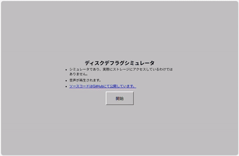

# Overview / 概要

Remember watching a hard disk defrag? DefragSim recreates that oddly soothing animation as a web app that runs in your browser.

\[日本語\]

ハードディスクのデフラグ処理を眺めていたことを覚えていますか？「DefragSim」は、あの妙に心地よいアニメーションをブラウザ上で再現するウェブアプリです。

# Video / 動画

# Motivation / 開発のきっかけ

Back in the day, there was something oddly soothing about mindlessly watching a hard disk defragment. Inspired by that, I made an animation mimicking it.

\[日本語\]

昔、ハードディスクのデフラグの様子をぼーっと見てるのって、なんか安らぎましたよね。ということで、デフラグツール風のアニメーションを表示するやつを作りました。

# Demo Site / デモサイト

You can try the demo site here: [https://cubic9.com/app/DefragSim/](https://cubic9.com/app/DefragSim/)

\[日本語\]

こちらでデモをご覧いただけます: [https://cubic9.com/app/DefragSim/](https://cubic9.com/app/DefragSim/)

# License / ライセンス

Copyright (C) 2025, cubic9com All rights reserved.

This project is licensed under the MIT license.

See the `LICENSE` file for details.
